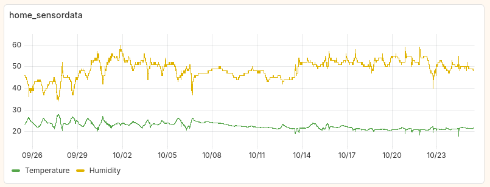
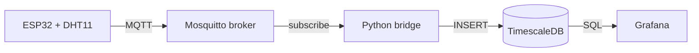

# ESP32 Climate Monitor

A self-hosted IoT pipeline that collects temperature and humidity readings from an ESP32 with a Grove DHT11 sensor and visualizes them on a Grafana dashboard. Everything except the sensor runs on a Raspberry Pi with Docker Compose.



## Architecture



1. The **ESP32** reads temperature and humidity and publishes them over WiFi to an MQTT topic.
2. **Mosquitto** receives the messages. Anonymous access is disabled and every client authenticates with its own user.
3. The **Python bridge** (`bridge/mqtt_to_postgres.py`) subscribes to the topic and writes each reading to the database.
4. **TimescaleDB** (PostgreSQL with time-series extensions) stores the readings.
5. **Grafana** queries TimescaleDB and displays the data.

## Tech stack

| Layer      | Technology                         |
|------------|------------------------------------|
| Sensor     | ESP32, Grove DHT11, Arduino framework |
| Messaging  | MQTT (Eclipse Mosquitto)           |
| Ingestion  | Python                             |
| Storage    | TimescaleDB / PostgreSQL           |
| Dashboard  | Grafana                            |
| Hosting    | Docker Compose on Raspberry Pi     |

## Repository structure

```
.
├── docker-compose.yaml
├── grafana_dashboard.png
├── .env.example              # template for database and MQTT credentials
├── bridge/
│   ├── Dockerfile
│   └── mqtt_to_postgres.py   # MQTT → TimescaleDB bridge
├── firmware/
│   └── esp32-sensor/
│       ├── dht_to_mqtt.ino
│       └── secrets.h.example # template for WiFi and MQTT credentials
└── mosquitto/
    ├── config/
    │   └── mosquitto.conf
    ├── data/                 # broker persistence (not committed)
    └── log/                  # broker logs (not committed)
```

## Secrets

No credentials are stored in this repository. Each part keeps them in a git-ignored file with a committed template:

| File                                  | Used by          | Template                     |
|---------------------------------------|------------------|------------------------------|
| `.env`                                | Docker services  | `.env.example`               |
| `mosquitto/config/pwfile`             | Mosquitto        | created with `mosquitto_passwd` |
| `firmware/esp32-sensor/secrets.h`     | ESP32 firmware   | `secrets.h.example`          |

## Getting started

### Prerequisites

- Raspberry Pi (or any Linux machine) with Docker and Docker Compose
- ESP32 board and a Grove DHT11 temperature/humidity sensor
- Arduino IDE with ESP32 board support

### 1. Clone and configure

```bash
git clone https://github.com/<username>/<repo-name>.git
cd <repo-name>
cp .env.example .env
```

Edit `.env` and set your own passwords.

### 2. Create MQTT users

Create one user for the ESP32 and one for the bridge. The `-c` flag creates the file, so only use it for the first user:

```bash
docker run --rm -it -v "$(pwd)/mosquitto/config:/mosquitto/config" eclipse-mosquitto \
  mosquitto_passwd -c /mosquitto/config/pwfile esp32_sensor

docker run --rm -it -v "$(pwd)/mosquitto/config:/mosquitto/config" eclipse-mosquitto \
  mosquitto_passwd /mosquitto/config/pwfile bridge_user
```

The bridge user and password must match `MQTT_USER` and `MQTT_PASSWORD` in `.env`.

### 3. Start the stack

```bash
docker compose up -d --build
docker compose ps
```

Grafana is available at `http://<pi-address>:3000`.

### 4. Flash the ESP32

```bash
cd firmware/esp32-sensor
cp secrets.h.example secrets.h
```

Fill in your WiFi credentials, the Pi's IP address and the `esp32_sensor` MQTT credentials. Then open `dht_to_mqtt.ino` in the Arduino IDE, select your ESP32 board and upload.

<!-- List the libraries the sketch needs, e.g. -->
<!-- Required libraries: AsyncMqttClient, DHT sensor library -->

<!-- Add your wiring, e.g.: Sensor data pin → GPIO 4, VCC → 3.3V, GND → GND -->

## Data format

<!-- Replace with your actual topic and payload -->
The ESP32 publishes to `sensors/<location>`:

```json
{"temperature": 21.4, "humidity": 48.2}
```

## License

MIT
